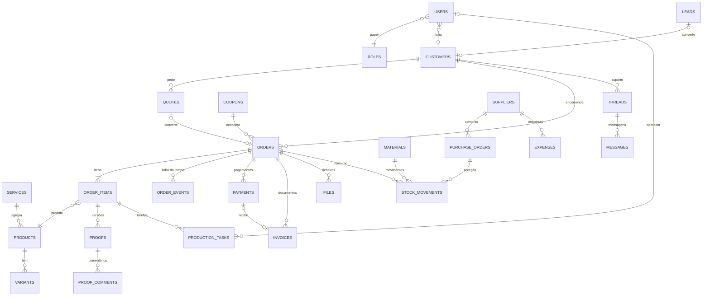

# 02 · Modelo de dados (Firestore)

## Convenções

- **Dinheiro**: inteiro em cêntimos de Kz (`Cents`). 150 000,00 Kz = `15000000`. Nunca `float`.
- **IVA**: taxa guardada em cada linha (`taxRate: 14`), imposto arredondado ao cêntimo por linha. Isenções levam o código de motivo exigido pela AGT.
- **Datas**: `Timestamp` do Firestore. Apresentação no fuso `Africa/Luanda` (UTC+1, sem horário de verão).
- **Telefones** em E.164 (`+244923456789`). **NIF** como string (empresa: 10 dígitos; particular: n.º do BI, 14 caracteres).
- **Metadados em todos os documentos**: `createdAt`, `updatedAt`, `createdBy`, `updatedBy` (omitidos abaixo).
- **Snapshots**: pedidos, orçamentos e faturas copiam nome, NIF, opções e preços no momento da criação. Mudar o catálogo ou a ficha do cliente não reescreve o histórico.
- **Nada financeiro é apagado.** Entidades de negócio usam `archivedAt`; faturas são anuladas, não removidas.
- **Pesquisa global**: campo `searchTokens: string[]` com prefixos em minúsculas (nome, telefone, NIF, número), consultado com `array-contains`.
  `shortcut: só procura por prefixo de uma palavra; passar a Typesense se a pesquisa Ctrl+K ficar curta.`
- **Agregados do dashboard**: consultas diretas + `count()`/`sum()` do Firestore, com cache de 5 min no servidor. Volume esperado de uma gráfica (50–80 pedidos/dia no pico) não justifica documentos de estatística pré-agregados. Rever se o dashboard passar 1 s.

```ts
type Cents = number;              // inteiro, cêntimos de Kz
type Province =                   // 21 províncias (divisão administrativa de 2024)
  | 'Bengo' | 'Benguela' | 'Bié' | 'Cabinda' | 'Cuando' | 'Cubango' | 'Cuanza Norte' | 'Cuanza Sul'
  | 'Cunene' | 'Huambo' | 'Huíla' | 'Ícolo e Bengo' | 'Luanda' | 'Lunda Norte' | 'Lunda Sul'
  | 'Malanje' | 'Moxico' | 'Moxico Leste' | 'Namibe' | 'Uíge' | 'Zaire';
type Sector =
  | 'banca_seguros' | 'petroleo_energia' | 'telecom' | 'restauracao_hotelaria' | 'saude'
  | 'educacao' | 'retalho' | 'governo_ong' | 'eventos' | 'construcao_imobiliario';
interface Media { publicId: string; alt: string; width: number; height: number; kind: 'image' | 'video' } // Cloudinary
interface Seo { title?: string; description?: string; ogImage?: Media; noindex?: boolean }
```

## Diagrama de relações



## Mapa de coleções

| Área | Coleção | Pedido no briefing |
|---|---|---|
| Acesso | `users`, `roles`, `invites` | utilizadores |
| CRM | `customers`, `customers/{id}/notes` | clientes |
| Catálogo | `services`, `products`, `products/{id}/variants`, `catalogOptions` | serviços, produtos, variantes |
| Vendas | `orders`, `orders/{id}/items`, `orders/{id}/events`, `quotes`, `quotes/{id}/versions` | pedidos, itens, orçamentos |
| Provas | `proofs`, `proofs/{id}/comments` | provas/aprovações |
| Ficheiros | `files` | (metadados de uploads) |
| Finanças | `payments`, `invoices`, `expenses`, `statementImports`, `statementImports/{id}/lines` | pagamentos, faturas, despesas |
| Produção | `productionTasks` | tarefas de produção |
| Stock | `materials`, `stockMovements`, `inventoryCounts` | stock |
| Compras | `suppliers`, `purchaseOrders` | fornecedores |
| Conteúdo | `projects`, `posts`, `pages`, `faqs`, `testimonials`, `banners` | portfólio, posts |
| Marketing | `coupons`, `coupons/{code}/redemptions`, `campaigns`, `leads`, `newsletterSubscribers`, `popups` | cupões |
| Comunicação | `notifications`, `deliveries`, `messageTemplates`, `threads`, `threads/{id}/messages` | notificações |
| Sistema | `auditLogs`, `settings`, `counters`, `rateLimits` | logs de auditoria, definições |

---

## Acesso

### `users/{uid}`
```ts
interface User {
  kind: 'cliente' | 'equipa';
  roleId: RoleId;                  // também em custom claims → regras do Firestore
  displayName: string;
  email?: string;
  phone?: string;
  photoUrl?: string;
  customerId?: string;             // → customers (contas de cliente)
  active: boolean;                 // desativar sem apagar
  notificationPrefs: { email: boolean; whatsapp: boolean; marketing: boolean }; // no painel é sempre ligado
  sectors?: ProductionSector[];    // equipa: setores onde trabalha
  lastLoginAt?: Timestamp;
}
type RoleId = 'cliente' | 'admin' | 'gestor' | 'designer' | 'operador' | 'financeiro' | 'atendimento';
```

### `roles/{roleId}`
```ts
interface Role {
  name: string;                    // 'Operador de produção'
  description: string;
  system: boolean;                 // papéis base não se apagam; o Administrador não se edita
  permissions: Partial<Record<Module, Action[]>>;      // { orders: ['view', 'edit', 'export'] }
  scope: Partial<Record<Module, 'all' | 'assigned'>>;  // 'assigned' = só registos atribuídos ao próprio
}
type Module = 'dashboard' | 'orders' | 'quotes' | 'customers' | 'production' | 'proofs' | 'catalog'
  | 'stock' | 'purchasing' | 'finance' | 'portfolio' | 'cms' | 'marketing' | 'messaging'
  | 'team' | 'reports' | 'audit' | 'settings';
type Action = 'view' | 'create' | 'edit' | 'delete' | 'approve' | 'export';
```

### `invites/{inviteId}`
```ts
interface Invite { email: string; roleId: RoleId; tokenHash: string; invitedBy: string;
  expiresAt: Timestamp; status: 'pendente' | 'aceite' | 'expirado' | 'revogado' }
```

## CRM

### `customers/{customerId}`
Ficha comercial, separada da conta de acesso: um pedido de balcão cria a ficha sem conta; uma empresa pode ter várias contas ligadas.
```ts
interface Customer {
  type: 'particular' | 'empresa';
  segment: 'particular' | 'empresa' | 'vip';
  name: string;                    // pessoa ou razão social
  tradeName?: string;
  nif?: string;
  email?: string;
  phone: string;
  whatsapp?: string;
  contacts: { name: string; role?: string; phone?: string; email?: string; userId?: string }[];
  addresses: Address[];
  tags: string[];                  // 'evento-dezembro', 'paga-a-30-dias'
  sector?: Sector;
  userIds: string[];               // contas com acesso a esta ficha
  accountManagerId?: string;       // → users
  paymentTerms: 'pronto' | 'sinal_50' | 'a_30_dias';
  creditLimit?: Cents;
  stats: { ordersCount: number; totalSpent: Cents; balanceDue: Cents; lastOrderAt?: Timestamp }; // Functions
  source?: LeadSource;
  searchTokens: string[];
  archivedAt?: Timestamp;
}
interface Address {
  id: string;
  label: string;                   // 'Escritório Talatona'
  recipient: string;
  phone: string;
  province: Province;
  municipality: string;
  neighborhood: string;
  street: string;
  reference?: string;              // ponto de referência ("junto ao Belas Shopping")
  isDefault: boolean;
}
```
`customers/{id}/notes/{noteId}`: `{ body: string; authorId: string; pinned: boolean }`

## Catálogo

### `services/{serviceId}` (páginas de serviço)
```ts
interface Service {
  slug: string;                    // 'grande-formato'
  name: string;                    // 'Grande formato'
  tagline: string;
  description: RichText;
  materials: string[];             // 'Lona frontlit 440 g', 'Vinil monomérico', 'PVC 5 mm'
  leadTime: { normalDays: number; urgentDays?: number; note?: string };
  priceFrom: Cents;
  gallery: Media[];
  productIds: string[];            // produtos configuráveis
  seo: Seo;
  sortOrder: number;
  active: boolean;
}
```

### `products/{productId}` (configurador)
```ts
interface Product {
  serviceId: string;
  slug: string;
  name: string;                    // 'Cartões de visita', 'Roll-up 85 × 200 cm'
  description: string;
  images: Media[];
  preview3d: 'card' | 'box' | 'banner' | 'flat' | 'none';
  optionGroups: OptionGroup[];
  pricing: PricingRules;
  consumption: ConsumptionRule[];  // baixa de stock ao entrar em produção
  leadTime: { normalDays: number; urgentDays: number };
  requiresArtwork: boolean;        // false em brindes de stock sem personalização
  requiresProof: boolean;
  fileRequirements?: {
    formats: ('pdf' | 'ai' | 'psd' | 'png' | 'jpg' | 'tiff')[];
    minDpi: number;                // 300 papelaria, 100 lonas
    bleedMm: number;               // 3
    colorMode: 'CMYK' | 'RGB';
    maxSizeMb: number;
  };
  allowDesignService: boolean;     // "preciso que a Endju crie o design"
  minQty: number;
  taxRate: number;                 // 14
  seo: Seo;
  sortOrder: number;
  active: boolean;
}
interface OptionGroup {
  key: string;                     // 'formato' | 'papel' | 'acabamento' | 'faces'
  label: string;
  required: boolean;
  type: 'select' | 'multi' | 'size';             // 'size' = largura × altura livre
  choices?: { key: string; label: string; optionId?: string; default?: boolean }[]; // optionId → catalogOptions
  size?: { minCm: number; maxCm: number; stepCm: number };
}
interface PricingRules {
  model: 'tiered_unit' | 'area_m2' | 'fixed';
  tiers?: { minQty: number; unitPrice: Cents }[]; // 100 un → 85 Kz/un; 500 un → 42 Kz/un
  pricePerM2?: Cents;
  minAreaM2?: number;
  fixedPrice?: Cents;
  setupFee?: Cents;                // arranque de máquina / montagem
  modifiers: { group: string; choice: string; type: 'add_unit' | 'add_m2' | 'add_fixed' | 'percent'; value: number }[];
  urgentSurchargePct: number;      // 50
  designFee?: Cents;
}
interface ConsumptionRule {
  materialId: string;              // → materials
  per: 'unit' | 'm2' | 'sheet';
  qty: number;                     // ex.: 1/21 folha SRA3 por cartão (imposição)
  wastePct: number;                // desperdício de afinação
  when?: { group: string; choice: string }; // só se esta opção estiver escolhida
}
```
O motor de preço (`src/lib/domain/pricing.ts`) é uma função pura destas regras: o cliente usa-a para a estimativa em tempo real; o servidor recalcula no checkout e ignora o preço enviado pelo browser.

### `products/{productId}/variants/{variantId}`
Para artigos com SKU fixo e stock próprio (brindes, fardamento): caneca branca 11 oz, t-shirt preta M.
```ts
interface Variant {
  sku: string;
  label: string;                   // 'Preta · M'
  options: Record<string, string>; // { cor: 'preta', tamanho: 'm' }
  priceOverride?: Partial<PricingRules>;
  materialId?: string;             // stock da peça em branco
  active: boolean;
}
```

### `catalogOptions/{optionId}` (materiais e acabamentos reutilizáveis)
```ts
interface CatalogOption {
  kind: 'material' | 'acabamento' | 'formato';
  name: string;                    // 'Laminação mate', 'Verniz UV localizado', 'Ilhoses a cada 50 cm'
  description?: string;
  image?: Media;
  materialId?: string;             // ligação ao stock
  active: boolean;
}
```

## Vendas

### `orders/{orderId}`
```ts
interface Order {
  number: string;                  // 'EDJ-2026-00412' (counters/orders, em transação)
  customerId: string;
  userId?: string;                 // vazio em pedidos de balcão
  customer: { name: string; nif?: string; phone: string; email?: string; type: 'particular' | 'empresa' }; // snapshot
  channel: 'site' | 'balcao' | 'whatsapp' | 'orcamento';
  quoteId?: string;
  status: OrderStatus;
  paymentStatus: 'pendente' | 'parcial' | 'pago' | 'reembolsado';
  priority: 'normal' | 'urgente';
  itemsSummary: { count: number; names: string[] };
  totals: { subtotal: Cents; discount: Cents; delivery: Cents; tax: Cents; total: Cents; paid: Cents; due: Cents };
  depositRequired: Cents;          // sinal exigido (50 % por omissão)
  coupon?: { code: string; discount: Cents };
  delivery: {
    method: 'levantamento' | 'entrega';
    pickupPointId?: string;
    zoneId?: string;
    address?: Address;
    fee: Cents;
    dispatchedAt?: Timestamp;
    carrier?: string;              // estafeta próprio, transportadora para províncias
    deliveredAt?: Timestamp;
    receivedBy?: string;
  };
  dueAt: Timestamp;                // prazo prometido, em dias úteis
  assigneeId?: string;             // responsável
  needsDesign: boolean;
  revisionCount: number;
  awaitingDeposit?: boolean;       // provas aprovadas, à espera do sinal para entrar em produção
  stockConsumedAt?: Timestamp;     // idempotência da baixa de stock
  cancel?: { reason: string; by: string; at: Timestamp };
  searchTokens: string[];
}
type OrderStatus = 'recebido' | 'em_design' | 'em_aprovacao' | 'em_producao' | 'pronto' | 'entregue' | 'cancelado';
```
"Atrasado" não é guardado: é a consulta `status in [ativos] && dueAt < agora`.

### `orders/{orderId}/items/{itemId}`
Subcoleção (e não array) para permitir `collectionGroup('items')`: produtos mais vendidos, provas e tarefas por item.
```ts
interface OrderItem {
  productId: string;
  variantId?: string;
  name: string;                    // snapshot: 'Cartões de visita · 85 × 55 mm'
  options: { group: string; label: string; choice: string; choiceLabel: string }[];
  size?: { widthCm: number; heightCm: number };
  quantity: number;
  urgent: boolean;
  design: 'cliente_envia' | 'endju_cria';
  artworkFileIds: string[];        // → files
  unitPrice: Cents;
  lineSubtotal: Cents;
  taxRate: number;
  lineTax: Cents;
  lineTotal: Cents;
  priceBreakdown: { label: string; amount: Cents }[]; // como o preço foi calculado
  proofStatus: 'nao_necessaria' | 'pendente' | 'enviada' | 'aprovada' | 'alteracoes';
  currentProofId?: string;
  createdAt: Timestamp;
}
```

### `orders/{orderId}/events/{eventId}` (linha do tempo + notas internas)
```ts
interface OrderEvent {
  type: 'status' | 'payment' | 'proof' | 'note' | 'file' | 'delivery' | 'assignment';
  visibility: 'cliente' | 'interno';  // o cliente só consegue ler 'cliente' (regra + consulta filtrada)
  from?: OrderStatus;
  to?: OrderStatus;
  message: string;                 // 'Prova v2 enviada para aprovação'
  actorId?: string;
  actorName: string;
  at: Timestamp;
}
```

### `quotes/{quoteId}`
```ts
interface Quote {
  number: string;                  // 'ORC-2026-00087'
  kind: 'personalizado' | 'catalogo';
  customerId?: string;
  leadId?: string;                 // visitante sem conta
  contact: { name: string; phone: string; email?: string; company?: string };
  request: { description: string; quantity?: string; deadline?: Timestamp; budgetRange?: string; fileIds: string[] };
  status: 'novo' | 'em_analise' | 'enviado' | 'aceite' | 'recusado' | 'expirado' | 'convertido';
  currentVersion: number;
  validUntil?: Timestamp;
  assigneeId?: string;
  orderId?: string;                // quando convertido
  sentAt?: Timestamp;
  respondedAt?: Timestamp;
  searchTokens: string[];
}
```
`quotes/{id}/versions/{n}`:
```ts
interface QuoteVersion {
  version: number;
  lines: { description: string; quantity: number; unitPrice: Cents; taxRate: number; productId?: string;
           options?: OrderItem['options'] }[];
  totals: { subtotal: Cents; discount: Cents; tax: Cents; total: Cents };
  terms: string;                   // sinal 50 %, prazo de produção, validade
  notes?: string;
  validUntil: Timestamp;
  pdfFileId: string;
}
```

### `proofs/{proofId}`
Coleção de topo: o módulo de provas lista todas, e cada prova pertence a um item.
```ts
interface Proof {
  orderId: string;
  orderNumber: string;
  itemId: string;
  itemName: string;                // snapshot do item, para a lista de provas
  customerId: string;
  userId: string;                  // conta do cliente: as regras deixam-no ler a prova em tempo real
  version: number;                 // v1, v2…
  status: 'pendente' | 'aprovada' | 'alteracoes_pedidas' | 'substituida';
  originalFileId: string;          // PDF de alta (Firebase Storage, privado)
  preview: { publicId: string; pages: number; width: number; height: number }; // Cloudinary, zoom
  designerId: string;
  message?: string;                // nota do designer
  sentAt: Timestamp;
  decision?: {                     // aprovação formal
    by: string;
    byName: string;
    at: Timestamp;                 // hora do servidor
    ip: string;
    userAgent: string;
    termsVersion: string;          // texto de aceitação que o cliente confirmou
    note?: string;
  };
}
```
`proofs/{id}/comments/{commentId}`:
```ts
interface ProofComment {
  authorId: string;
  authorName: string;
  authorKind: 'cliente' | 'equipa';
  body: string;
  page: number;
  pin?: { x: number; y: number };  // 0–1, relativo à página
  resolved: boolean;
}
```

### `files/{fileId}`
```ts
interface FileRecord {
  ownerId: string;
  customerId?: string;
  orderId?: string;
  itemId?: string;
  quoteId?: string;
  purpose: 'arte' | 'prova' | 'comprovativo' | 'fatura' | 'proposta' | 'anexo';
  storage: 'firebase' | 'cloudinary';   // privados no Storage; públicos e pré-visualizações no Cloudinary
  path: string;                    // caminho no Storage ou publicId
  name: string;
  mime: string;
  sizeBytes: number;
  preflight?: {
    status: 'pendente' | 'ok' | 'avisos' | 'erro';
    widthPx?: number;
    heightPx?: number;
    dpi?: number;
    pages?: number;
    colorMode?: string;
    trimMm?: { w: number; h: number };
    bleedMm?: number;
    messages: string[];            // 'Resolução de 150 dpi no tamanho final; recomendado 300 dpi'
  };
}
```

### `coupons/{CODE}`
```ts
interface Coupon {
  type: 'percent' | 'fixed' | 'free_delivery';
  value: number;                   // % ou Cents
  minSubtotal?: Cents;
  maxDiscount?: Cents;
  startsAt: Timestamp;
  endsAt?: Timestamp;
  usageLimit?: number;
  usedCount: number;
  perCustomerLimit?: number;
  firstOrderOnly: boolean;
  productIds?: string[];
  serviceIds?: string[];
  campaignId?: string;
  active: boolean;
}
```
`coupons/{CODE}/redemptions/{orderId}`: `{ customerId: string; discount: Cents; at: Timestamp }`

## Finanças

### `payments/{paymentId}`
```ts
interface Payment {
  orderId: string;
  orderNumber: string;
  customerId: string;
  kind: 'sinal' | 'restante' | 'total';
  method: 'multicaixa_express' | 'referencia' | 'transferencia' | 'numerario' | 'tpa';
  amount: Cents;
  status: 'pendente' | 'aguarda_validacao' | 'confirmado' | 'falhado' | 'expirado' | 'reembolsado';
  provider?: {
    name: string;                  // gateway escolhido
    transactionId?: string;
    entity?: string;               // pagamento por referência
    reference?: string;
    expiresAt?: Timestamp;
    raw?: Record<string, unknown>; // último payload do webhook
  };
  transferProofFileId?: string;    // comprovativo de transferência
  confirmedBy?: string;            // 'webhook' ou uid
  confirmedAt?: Timestamp;
  receiptInvoiceId?: string;
  reconciliation?: { lineId: string; matchedAt: Timestamp; matchedBy: string };
}
```

### `invoices/{invoiceId}`
O sistema **não emite faturas fiscais por si**: em Angola têm de sair de software certificado pela AGT. Este documento guarda a cópia e o estado da sincronização; pro-formas e propostas são internas.
```ts
interface Invoice {
  docType: 'proforma' | 'fatura' | 'fatura_recibo' | 'recibo' | 'nota_credito';
  number: string;                  // fiscal: vem do software certificado; pro-forma: 'PF-2026-00120'
  status: 'rascunho' | 'emitida' | 'anulada';
  orderId?: string;
  quoteId?: string;
  paymentId?: string;
  relatedInvoiceId?: string;       // nota de crédito → fatura
  customerId: string;
  customer: { name: string; nif?: string; address?: string }; // snapshot
  lines: { description: string; quantity: number; unitPrice: Cents; discount: Cents; taxRate: number;
           taxExemptionCode?: string; total: Cents }[];
  totals: { subtotal: Cents; discount: Cents; tax: Cents; total: Cents };
  taxBreakdown: { rate: number; base: Cents; tax: Cents }[];
  issuedAt: Timestamp;
  dueAt?: Timestamp;
  fiscal?: {
    provider: string;
    externalId: string;
    hash?: string;
    qrCode?: string;
    syncedAt: Timestamp;
    status: 'ok' | 'erro';
    error?: string;
  };
  pdfFileId?: string;
}
```

### `expenses/{expenseId}`
```ts
interface Expense {
  category: 'materia_prima' | 'renda' | 'energia_gerador' | 'combustivel' | 'salarios' | 'manutencao'
    | 'internet_telecom' | 'marketing' | 'transporte' | 'impostos' | 'outros';
  description: string;
  supplierId?: string;
  purchaseOrderId?: string;
  amount: Cents;
  taxAmount: Cents;
  date: Timestamp;
  dueAt?: Timestamp;
  status: 'pendente' | 'pago';
  paidAt?: Timestamp;
  paymentMethod?: string;
  attachmentFileId?: string;
  recurring?: { every: 'mes' };    // ao pagar, cria a do mês seguinte
}
```

### `statementImports/{importId}` (conciliação Multicaixa / banco)
```ts
interface StatementImport {
  source: 'multicaixa' | 'banco';
  bankName?: string;
  periodFrom: Timestamp;
  periodTo: Timestamp;
  fileId: string;                  // CSV do extrato
  linesCount: number;
  matchedCount: number;
}
// statementImports/{id}/lines/{lineId}
interface StatementLine {
  date: Timestamp;
  amount: Cents;
  reference?: string;
  description: string;
  status: 'por_conciliar' | 'conciliada' | 'ignorada';
  paymentId?: string;
}
```

## Produção

### `productionTasks/{taskId}`
```ts
interface ProductionTask {
  orderId: string;
  orderNumber: string;
  itemId: string;
  itemName: string;
  customerName: string;
  sector: ProductionSector;
  machineId?: string;              // settings/production.machines
  assigneeId?: string;
  status: 'por_fazer' | 'em_curso' | 'pausada' | 'concluida' | 'bloqueada';
  priority: 1 | 2 | 3;             // 3 = urgente (número para ordenar)
  sequence: number;                // posição na fila do setor
  dueAt: Timestamp;
  estimatedMinutes?: number;
  timeLogs: { userId: string; start: Timestamp; end?: Timestamp }[];
  dependsOn?: string[];            // impressão → corte → acabamento
  blockedReason?: string;
  notes?: string;
}
type ProductionSector = 'design' | 'impressao' | 'corte' | 'acabamento' | 'expedicao';
```

## Stock e compras

### `materials/{materialId}`
```ts
interface Material {
  sku: string;
  name: string;                    // 'Papel couché mate 350 g SRA3', 'Lona frontlit 440 g · rolo 3,20 m'
  category: 'papel' | 'vinil' | 'lona' | 'tinta' | 'rigido' | 'textil' | 'brinde' | 'embalagem' | 'consumivel';
  unit: 'folha' | 'm2' | 'ml' | 'rolo' | 'unidade' | 'kg';
  qty: number;                     // atualizado na mesma transação do movimento
  minQty: number;
  isLow: boolean;                  // qty <= minQty; guardado porque o Firestore não compara dois campos
  avgCost: Cents;                  // custo médio ponderado
  supplierIds: string[];
  location?: string;
  active: boolean;
}
```

### `stockMovements/{movementId}`
```ts
interface StockMovement {
  materialId: string;
  materialName: string;
  type: 'entrada' | 'saida' | 'ajuste' | 'inventario';
  qty: number;                     // com sinal
  balanceAfter: number;
  unitCost?: Cents;
  orderId?: string;
  productionTaskId?: string;
  purchaseOrderId?: string;
  inventoryCountId?: string;
  reason: string;
  by: string;
  at: Timestamp;
}
```

### `inventoryCounts/{countId}`
```ts
interface InventoryCount {
  status: 'aberta' | 'fechada';
  lines: { materialId: string; expected: number; counted?: number }[];
  closedAt?: Timestamp;            // ao fechar, gera movimentos 'inventario' com as diferenças
}
```

### `suppliers/{supplierId}`
```ts
interface Supplier {
  name: string;
  nif?: string;
  contacts: { name: string; phone?: string; email?: string }[];
  categories: Material['category'][];
  paymentTermsDays: number;
  iban?: string;
  address?: string;
  rating?: 1 | 2 | 3 | 4 | 5;
  notes?: string;
  active: boolean;
  searchTokens: string[];
}
```

### `purchaseOrders/{poId}`
```ts
interface PurchaseOrder {
  number: string;                  // 'OC-2026-00031'
  supplierId: string;
  supplierName: string;
  status: 'rascunho' | 'enviada' | 'parcial' | 'recebida' | 'cancelada';
  lines: { materialId: string; description: string; qty: number; unitCost: Cents; receivedQty: number }[];
  totals: { subtotal: Cents; tax: Cents; total: Cents };
  expectedAt?: Timestamp;
  approvedBy?: string;
  payable: { dueAt: Timestamp; paid: Cents; status: 'por_pagar' | 'parcial' | 'pago' }; // contas a pagar
}
```

## Conteúdo

```ts
// projects/{projectId} — portfólio
interface PortfolioProject {
  slug: string;
  title: string;
  clientName: string;
  clientVisible: boolean;          // nome do cliente só com autorização
  sector: Sector;
  serviceIds: string[];
  cover: Media;
  gallery: Media[];
  beforeAfter?: { before: Media; after: Media };
  challenge: RichText;
  solution: RichText;
  result: RichText;
  metrics?: { label: string; value: string }[];   // '3 500 peças em 72 h'
  testimonialId?: string;
  featured: boolean;
  sortOrder: number;
  status: 'rascunho' | 'publicado';
  publishedAt?: Timestamp;
  seo: Seo;
}

// posts/{postId}
interface Post {
  slug: string;
  title: string;
  excerpt: string;
  content: TiptapJSON;
  cover: Media;
  authorId: string;
  tags: string[];
  status: 'rascunho' | 'agendado' | 'publicado';
  publishAt?: Timestamp;           // agendado: o site mostra quando publishAt <= agora (sem job)
  readingMinutes: number;
  seo: Seo;
}

// pages/{slug} — sobre, privacidade, termos
interface Page { title: string; blocks: ContentBlock[]; seo: Seo }

// faqs/{faqId}
interface Faq { question: string; answer: string; category: 'encomendas' | 'ficheiros' | 'pagamentos' | 'entregas' | 'geral'; sortOrder: number; active: boolean }

// testimonials/{id}
interface Testimonial { author: string; role: string; company: string; quote: string; rating?: number; photo?: Media; projectId?: string; featured: boolean; active: boolean }

// banners/{id}
interface Banner { placement: 'home_hero' | 'home_strip' | 'site_topbar'; title: string; body?: string; cta?: { label: string; href: string }; image?: Media; startsAt?: Timestamp; endsAt?: Timestamp; active: boolean }
```

## Marketing

```ts
// campaigns/{id}
interface Campaign {
  name: string;
  channel: 'email' | 'whatsapp' | 'site' | 'redes';
  startsAt: Timestamp;
  endsAt?: Timestamp;
  couponCodes: string[];
  utmCampaign: string;
  budget?: Cents;
  status: 'rascunho' | 'ativa' | 'terminada';
  stats: { sent: number; clicks: number; orders: number; revenue: Cents };
}

// leads/{id} — funil
interface Lead {
  name: string;
  phone?: string;
  email?: string;
  company?: string;
  source: LeadSource;
  interest?: string;
  message?: string;
  stage: 'novo' | 'contactado' | 'qualificado' | 'proposta' | 'ganho' | 'perdido';
  lostReason?: string;
  assigneeId?: string;
  customerId?: string;
  quoteId?: string;
  utm?: { source?: string; medium?: string; campaign?: string };
  searchTokens: string[];
}
type LeadSource = 'contacto' | 'orcamento' | 'popup' | 'newsletter' | 'whatsapp' | 'telefone' | 'balcao';

// newsletterSubscribers/{id} — dupla confirmação
interface Subscriber { email: string; name?: string; status: 'pendente' | 'confirmado' | 'cancelado'; confirmedAt?: Timestamp; source: LeadSource; tags: string[] }

// popups/{id}
interface Popup {
  name: string;
  trigger: 'tempo' | 'scroll' | 'saida';
  delaySec?: number;
  scrollPct?: number;
  paths: string[];                 // páginas onde aparece
  content: { title: string; body: string; cta: string };
  couponCode?: string;
  frequencyDays: number;
  active: boolean;
  stats: { views: number; conversions: number };
}
```

## Comunicação

```ts
// notifications/{id} — painel (cliente e equipa)
interface Notification {
  recipientId: string;
  event: NotificationEvent;
  title: string;
  body: string;
  link: string;                    // '/conta/provas/abc' ou '/admin/pedidos/EDJ-2026-00412'
  read: boolean;
}
type NotificationEvent =
  | 'pedido.estado' | 'pagamento.pendente' | 'pagamento.comprovativo' | 'pagamento.confirmado' | 'prova.enviada' | 'prova.decisao'
  | 'prazo.a_expirar' | 'orcamento.novo' | 'orcamento.enviado' | 'stock.baixo' | 'mensagem.nova' | 'tarefa.atribuida';

// deliveries/{id} — histórico de envios por email/WhatsApp
interface Delivery {
  channel: 'email' | 'whatsapp';
  event: NotificationEvent;
  templateId: string;
  to: string;
  recipientId?: string;
  orderId?: string;
  status: 'enviado' | 'falhado' | 'entregue' | 'lido';
  providerMessageId?: string;
  error?: string;
}

// messageTemplates/{event__channel}
interface MessageTemplate {
  event: NotificationEvent;
  channel: 'email' | 'whatsapp';
  subject?: string;
  body: string;                    // 'Olá {{cliente.nome}}, o pedido {{pedido.numero}} está pronto para levantamento.'
  whatsappTemplateName?: string;   // modelo aprovado pela Meta
  active: boolean;
}

// threads/{id} — suporte (criada pelo cliente na área de cliente ou pela equipa)
interface Thread {
  userId: string;                  // conta do cliente: as regras deixam-no ler a conversa em tempo real
  customerName: string;
  subject: string;
  orderNumber?: string;
  status: 'aberta' | 'fechada';
  assigneeId?: string;
  lastMessageAt: Timestamp;
  unreadByCustomer: boolean;       // resposta da equipa por ler
  unreadByTeam: boolean;
}
// threads/{id}/messages/{id}
interface Message { authorId: string; authorKind: 'cliente' | 'equipa' | 'sistema'; body: string; fileIds: string[] }
```

## Sistema

```ts
// auditLogs/{id} — imutável; escrito no mesmo batch da mutação
interface AuditLog {
  actorId: string;
  actorName: string;
  actorRole: RoleId;
  action: string;                  // 'order.status_changed', 'payment.confirmed', 'role.updated'
  entity: { type: string; id: string; label: string };  // label: 'EDJ-2026-00412'
  before?: Record<string, unknown>; // só os campos alterados
  after?: Record<string, unknown>;
  ip?: string;
  userAgent?: string;
  at: Timestamp;
}

// settings/{secção} — um documento por separador das Definições
interface CompanySettings {        // settings/company
  legalName: string;               // 'ENDJU BUSINESS'
  nif: string;
  address: string;
  phones: string[];
  whatsapp: string;
  email: string;
  logo: Media;
  bankAccounts: { bank: string; iban: string; holder: string }[];
  socials: Record<string, string>;
  openingHours: { day: 0 | 1 | 2 | 3 | 4 | 5 | 6; open: string; close: string }[];
}
interface TaxSettings { vatRate: 14; exemptions: { code: string; label: string }[]; publicPricesIncludeVat: boolean } // settings/tax
interface PaymentSettings {        // settings/payments
  methods: Record<Payment['method'], boolean>;
  depositPct: number;              // 50
  referenceValidityHours: number;
}
interface DeliverySettings {       // settings/delivery
  pickupPoints: { id: string; name: string; address: string; hours: string }[];
  zones: { id: string; name: string; provinces: Province[]; municipalities?: string[]; fee: Cents; extraDays: number; active: boolean }[];
}
interface ProductionSettings {     // settings/production
  machines: { id: string; name: string; sector: ProductionSector; active: boolean }[];
  workingDays: number[];           // 1–6 (segunda a sábado)
  includedRevisions: number;       // revisões de prova incluídas no preço (3)
}
interface IntegrationSettings {    // settings/integrations — só interruptores; segredos ficam em variáveis de ambiente
  email: { enabled: boolean };
  whatsapp: { enabled: boolean };
  mcx: { enabled: boolean; mode: 'teste' | 'producao' };
  invoicing: { enabled: boolean; provider: string };
}

// counters/{orders|quotes|purchaseOrders|proformas} — numeração sequencial por ano, em transação
interface Counter { year: number; value: number }

// rateLimits/{hash} — limite de pedidos por IP/utilizador; política TTL em expiresAt
interface RateLimit { count: number; windowStart: Timestamp; expiresAt: Timestamp }
```

---

## Índices compostos

| Coleção | Campos | Serve |
|---|---|---|
| `orders` | `status` ↑, `createdAt` ↓ | tabela e Kanban por estado |
| `orders` | `status` ↑, `dueAt` ↑ | urgentes e atrasados |
| `orders` | `customerId` ↑, `createdAt` ↓ | histórico do cliente |
| `orders` | `assigneeId` ↑, `status` ↑, `dueAt` ↑ | "os meus pedidos" |
| `orders` | `paymentStatus` ↑, `createdAt` ↓ | pagamentos em falta |
| `orders` | `searchTokens` (array), `createdAt` ↓ | pesquisa |
| `items` (collection group) | `productId` ↑, `createdAt` ↓ | mais vendidos |
| `quotes` | `status` ↑, `createdAt` ↓ | por responder |
| `quotes` | `customerId` ↑, `createdAt` ↓ | área do cliente |
| `proofs` | `status` ↑, `sentAt` ↓ | provas por aprovar |
| `proofs` | `customerId` ↑, `status` ↑, `sentAt` ↓ | área do cliente |
| `proofs` | `orderId` ↑, `itemId` ↑, `version` ↓ | versões de um item |
| `payments` | `status` ↑, `createdAt` ↓ | pendentes / a validar |
| `payments` | `method` ↑, `status` ↑, `confirmedAt` ↓ | conciliação |
| `payments` | `orderId` ↑, `createdAt` ↓ | pagamentos do pedido |
| `invoices` | `customerId` ↑, `issuedAt` ↓ | faturas do cliente |
| `invoices` | `docType` ↑, `status` ↑, `issuedAt` ↓ | financeiro |
| `productionTasks` | `sector` ↑, `status` ↑, `priority` ↓, `sequence` ↑ | fila por setor |
| `productionTasks` | `assigneeId` ↑, `status` ↑, `dueAt` ↑ | fila do operador |
| `productionTasks` | `machineId` ↑, `status` ↑, `sequence` ↑ | fila por máquina |
| `stockMovements` | `materialId` ↑, `at` ↓ | movimentos de um material |
| `materials` | `isLow` ↑, `name` ↑ | alertas de stock baixo |
| `expenses` | `category` ↑, `date` ↓ | despesas por categoria |
| `expenses` | `status` ↑, `dueAt` ↑ | contas a pagar |
| `purchaseOrders` | `supplierId` ↑, `createdAt` ↓ | histórico do fornecedor |
| `customers` | `segment` ↑, `stats.totalSpent` ↓ | segmentação / VIP |
| `customers` | `tags` (array), `name` ↑ | filtros por etiqueta |
| `leads` | `stage` ↑, `createdAt` ↓ | funil |
| `notifications` | `recipientId` ↑, `read` ↑, `createdAt` ↓ | sino de notificações |
| `threads` | `customerId` ↑, `lastMessageAt` ↓ | mensagens do cliente |
| `threads` | `status` ↑, `lastMessageAt` ↓ | caixa de suporte |
| `auditLogs` | `entity.type` ↑, `at` ↓ | filtro por tipo |
| `auditLogs` | `entity.id` ↑, `at` ↓ | histórico de um registo |
| `auditLogs` | `actorId` ↑, `at` ↓ | ações de um utilizador |
| `projects` | `status` ↑, `featured` ↓, `sortOrder` ↑ | portfólio em destaque |
| `projects` | `serviceIds` (array), `status` ↑, `publishedAt` ↓ | filtro por categoria |
| `projects` | `sector` ↑, `status` ↑, `publishedAt` ↓ | filtro por setor |
| `posts` | `status` ↑, `publishAt` ↓ | blog |
| `posts` | `tags` (array), `status` ↑, `publishAt` ↓ | blog por etiqueta |

Políticas TTL: `rateLimits.expiresAt`.
