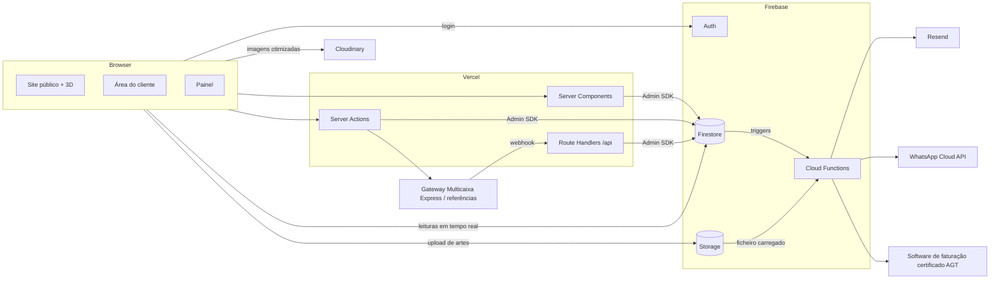
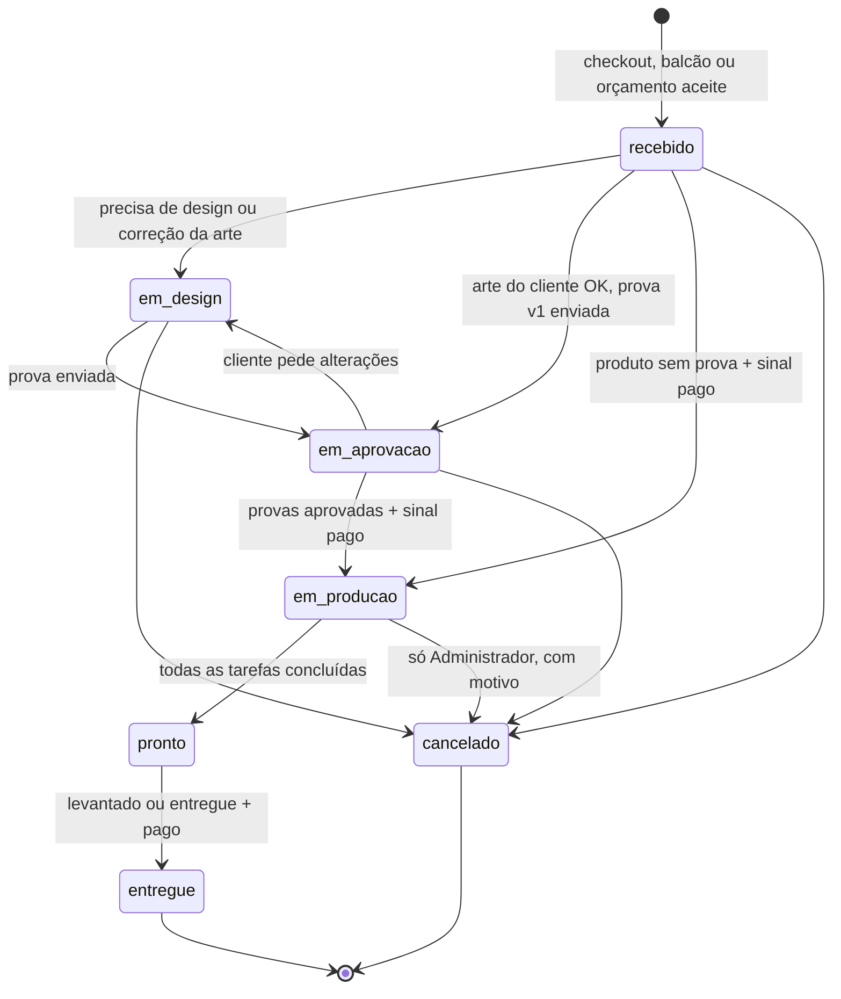
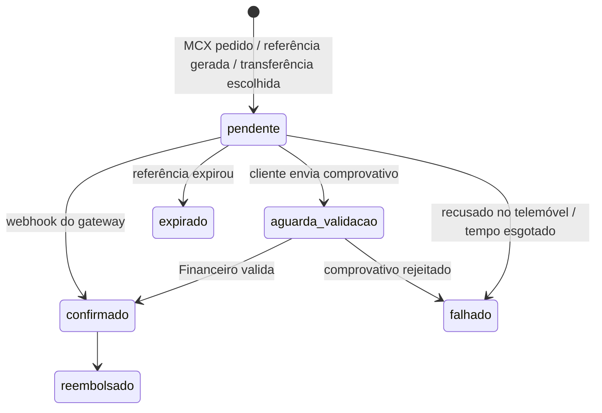
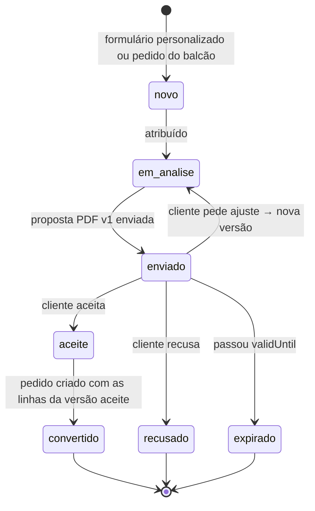
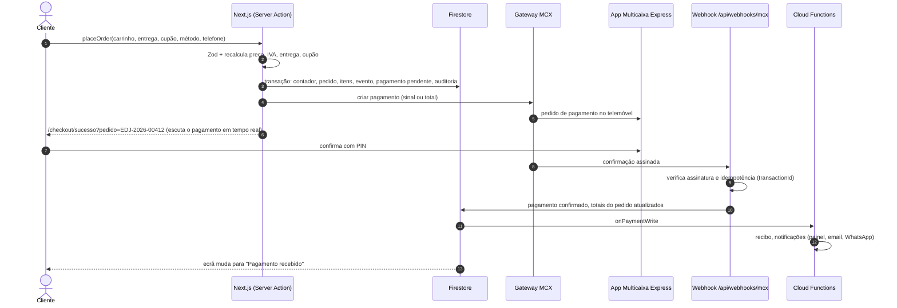
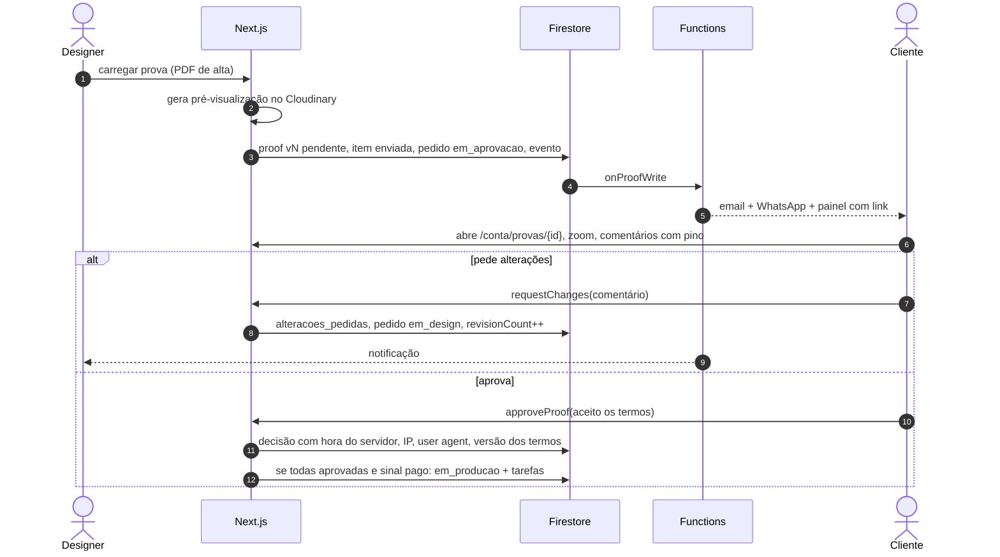
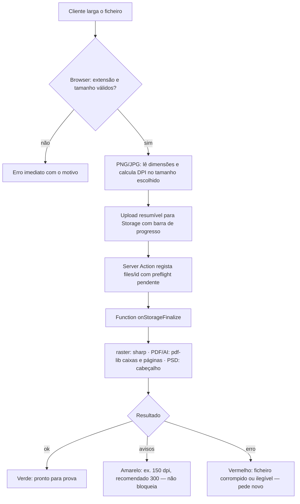
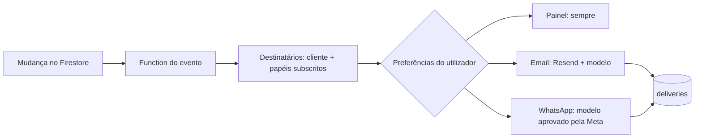
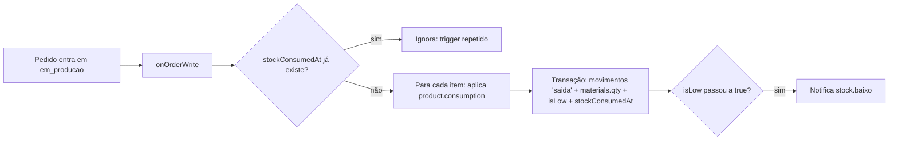
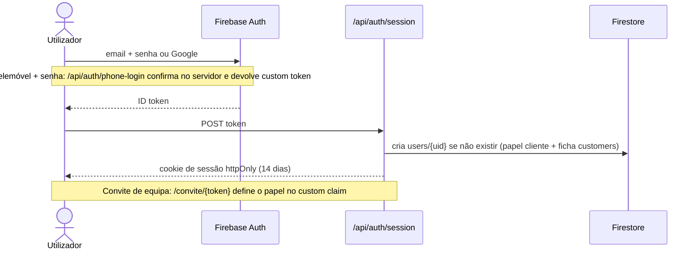

# 04 · Fluxos e estados

## Arquitetura

---

## Estado do pedido

O pedido tem **dois eixos independentes**: `status` (produção, o que o cliente vê na linha do tempo) e `paymentStatus` (dinheiro). As guardas cruzam os dois.

| Transição | Quem | Guarda | Efeitos |
|---|---|---|---|
| → `recebido` | sistema | preço recalculado no servidor; cupão válido | número `EDJ-AAAA-NNNNN`, pagamento `pendente`, evento, email de confirmação |
| `recebido → em_design` | Gestor, Atendimento, Designer | item com `design = endju_cria` ou arte rejeitada no preflight | tarefa no setor `design` |
| `recebido → em_aprovacao` | Designer | prova v1 carregada | notifica o cliente |
| `recebido → em_producao` | sistema | `requiresProof = false` em todos os itens **e** `paid ≥ depositRequired` | cria tarefas, baixa de stock, recalcula `dueAt` |
| `em_design → em_aprovacao` | Designer | prova carregada para cada item que a exige | notifica o cliente |
| `em_aprovacao → em_design` | Cliente, Designer | — | `revisionCount++`; acima das revisões incluídas (3) avisa o Atendimento do custo extra |
| `em_aprovacao → em_producao` | sistema | todas as provas `aprovada` **e** `paid ≥ depositRequired` | igual a acima. Sem sinal: fica em `em_aprovacao` com o selo "Aprovado · a aguardar sinal" |
| `em_producao → pronto` | sistema / Operador | última tarefa `concluida` | notifica "pronto para levantamento" ou "a preparar envio" |
| `pronto → entregue` | Atendimento, Gestor | `paymentStatus = pago` (o restante pode ser registado no ato) | guarda `deliveredAt`, `receivedBy`; pede avaliação |
| `* → cancelado` | Cliente (só `recebido` sem pagamentos), Atendimento, Gestor | antes de `em_producao` | liberta cupão; reembolso conforme os Termos |
| `em_producao → cancelado` | Administrador | motivo obrigatório | o stock consumido não volta; fica na auditoria |

**Prazo (`dueAt`)**: estimado no checkout; recalculado ao entrar em produção = data de entrada + `leadTime.normalDays` (ou `urgentDays`) em dias úteis de `settings/production.workingDays` + `extraDays` da zona de entrega. Regra comunicada ao cliente: *o prazo conta a partir da aprovação da prova e do pagamento do sinal*.

**Atrasado** = `status ∈ {recebido, em_design, em_aprovacao, em_producao}` e `dueAt < agora`.

**Saída para entrega**: não é um estado próprio. A saída para entrega fica como evento na linha do tempo ("Saiu para entrega às 10:42 · estafeta Endju"), dentro de `pronto`.

## Estado do pagamento

`order.paymentStatus` deriva da soma dos pagamentos `confirmado`: `0` → `pendente`; `< total` → `parcial`; `≥ total` → `pago`.
O sinal é `depositRequired = round(total × depositPct)`; clientes com `paymentTerms = 'a_30_dias'` têm sinal 0.

## Estado do orçamento

Taxa de conversão = `convertido / (enviado + aceite + recusado + expirado + convertido)` no período.

---

## Checkout e pagamento Multicaixa Express

- Referência: o passo 5 devolve entidade + referência + validade, mostradas no ecrã e enviadas por email/WhatsApp. O webhook chega quando o cliente paga num ATM ou no app.
- Transferência: o ecrã mostra o IBAN de `settings/company`; o cliente carrega o comprovativo → `aguarda_validacao` → o Financeiro valida.
- Rede de segurança: `scheduledDeadlines` consulta o gateway para pagamentos `pendente` há mais de 15 min (webhook perdido).

## Aprovação de prova

Texto de aceitação (versionado em `termsVersion`): *"Revi textos, ortografia, cores, dimensões e contactos. Autorizo a produção tal como está nesta prova."*

## Upload e preflight de ficheiros

Avisos não bloqueiam a encomenda: o designer revê-os antes de enviar a prova. Ficheiros `.ai` sem compatibilidade PDF ficam "não analisado · revisão manual".

## Notificações

| Evento | Cliente | Equipa |
|---|---|---|
| `pedido.estado` | sim | responsável do pedido |
| `pagamento.pendente` (24 h antes de a referência expirar) | sim | — |
| `pagamento.comprovativo` | — | Financeiro |
| `pagamento.confirmado` | sim | Financeiro |
| `prova.enviada` | sim | — |
| `prova.decisao` | — | Designer, responsável |
| `prazo.a_expirar` (24 h) | — | responsável, Gestor |
| `orcamento.novo` | — | Atendimento, Gestor |
| `orcamento.enviado` | sim | — |
| `stock.baixo` | — | Gestor |
| `mensagem.nova` | sim (resposta da equipa) | Atendimento |
| `tarefa.atribuida` | — | operador atribuído |

## Consumo de stock

Todas as Functions são idempotentes: os triggers do Firestore podem disparar mais de uma vez.

## Autenticação e papéis

